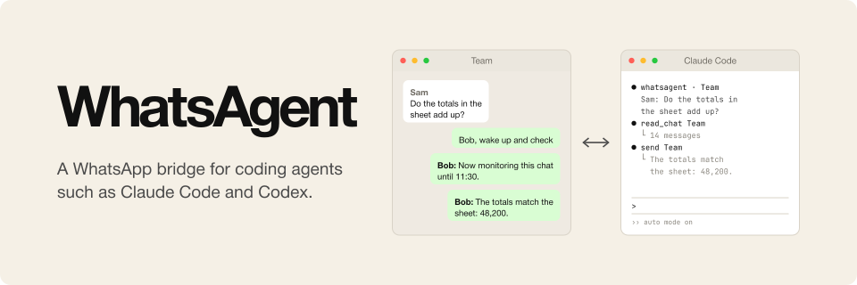

# WhatsAgent

<p align="center">
  
</p>

WhatsAgent is a WhatsApp bridge for coding agents such as Claude Code and Codex. It links to your WhatsApp account as a linked device, so you can talk to your agents from your phone, let them read a chat when you ask, and have them answer from your account under their own name.

You control it from your "Message Yourself" chat. Messages that start with `/` are commands for WhatsAgent, and every other message goes to home, an agent that WhatsAgent keeps running for you. In any other chat, "Bob, wake up" lets an agent read along and help for an hour.

WhatsAgent runs on Linux and macOS. It is not affiliated with or endorsed by WhatsApp or Meta. It uses an unofficial WhatsApp client, and WhatsApp can ban numbers that send automated messages, so WhatsAgent spaces its sends at least two seconds apart.

## Install

You need Go 1.26.10 or later, and Claude Code for home and the chat agents. Home can run on Codex instead.

```sh
go install github.com/osolmaz/WhatsAgent/cmd/whatsagent@latest
whatsagent link --phone +15551234567   # prints a code to enter on your phone
whatsagent service install             # runs the daemon as a user service
whatsagent setup claude                # gives every Claude Code session the WhatsApp tools
whatsagent setup codex                 # the same for Codex
```

`whatsagent link --phone` prints a code; on your phone, open WhatsApp, go to Linked devices, choose "Link with phone number", and enter it. Without `--phone`, `whatsagent link` prints a QR code to scan there instead. `whatsagent link --import <session.db>` takes over the login of another whatsmeow-based tool; stop that tool first, because two programs on one linked device disconnect each other.

Then send `/home claude` or `/home codex` in your "Message Yourself" chat to start home. Home on Codex runs as a thread on Codex's app-server daemon, so start that daemon first with `codex app-server daemon start`.

To let Claude Code or Codex do the install, paste this into it:

> Install WhatsAgent from https://github.com/osolmaz/WhatsAgent by following the Install section of its README. Ask me for my phone number first. Run `whatsagent link --phone <number>` in the background with its output in a file, tell me the code it prints, and wait until it says the account is linked. Then install the service, run `whatsagent setup` for the agent you are, and, if you are Codex, run `codex app-server daemon start`. Finally tell me to send `/home claude` or `/home codex` in my "Message Yourself" chat.

## Use

In your "Message Yourself" chat, send `/help` for the commands. The most useful ones:

| Command | Effect |
| --- | --- |
| `/status` | WhatsApp link, home, sessions and open windows |
| `/home claude` | Run home on Claude Code; `/home codex`, `/home off` and `/home new` also work |
| `/name Bob` | Name the agents; the name is also their trigger word |
| `/mode <chat> off\|keyword\|window\|all` | Set what agents see of a chat; `*` sets every chat |
| `/route <chat> <session> [<mode>]` | Let one of your sessions handle a chat; the mode defaults to `all` |
| `/chats <query>` | Find a chat by name |

### Chat modes

Each chat has a mode that decides what an agent sees of it. In the default `window` mode, the agent sees nothing until you wake it in the chat with its name and a wake phrase, such as "Bob, wake up" or "Bob start". It can then read the last 30 minutes and every new message for an hour. Naming it again extends that hour, and "Bob stop watching" ends it. The agent says in the chat when it starts monitoring and when it is done. Only your own messages can wake it, never other people's.

The `keyword` mode shows the agent only your messages that name it, `all` shows everything, and `off` shows nothing. A chat without a route gets its own agent, which has only WhatsAgent's tools and web search, so it can read only what the chat's mode shows. `/window` changes the window length, the lookback, the wake and stop phrases, and the two messages. The [chat modes specification](docs/2026-11-01-chat-modes.md) has the details.

### Agent messages

Agents write only their message, and WhatsAgent puts a prefix in front of it so people can tell the agent's messages from yours. `/prefix` sets it as any text, with `{name}` and `{session}` filled in, `\n` for a line break, and WhatsApp formatting such as `*bold*`. The default, `🤖 *{name}*:`, makes a message read "🤖 **Bob**: On it."

An agent answers on its own only in a chat that just wrote to it. Anything else, such as a message to another chat, waits for your yes. WhatsAgent asks in the chat where you last talked to that agent, or in your "Message Yourself" chat, and you answer with the two-digit code, such as `yes 42` or `no 42`. WhatsAgent writes the question itself from the real action, with the target chat and the exact text, so an agent cannot misrepresent it; `/approvals self` sends every such question to your "Message Yourself" chat. Home and the chat agents approve their own tool calls with Claude Code's auto mode or Codex's auto review, and ask you only when that cannot decide; `/auto off` makes them ask every time.

### Watching the agents

Home and the chat agents run as normal Claude Code sessions in terminals that the daemon keeps. `whatsagent web` opens them in your browser: the sessions on the left, and the selected agent's terminal on the right, where you can watch it work and type into it. Closing the tab leaves them running. When WhatsAgent starts a chat's agent and no page is open, it opens one in your default browser by itself, at most once a minute; `/browser off` stops that. The page listens only on this machine by default; to open it from another device on your Tailscale network, install the service with `whatsagent service install --web-host <tailscale address> --web-name <machine>.<tailnet>.ts.net`, and `whatsagent web --print` then gives you the link. The link holds an access token, so keep it private.

### Your own sessions

Your own agent sessions can take part too. Every Claude Code and Codex session has the WhatsApp tools after `whatsagent setup`, and a session can ask for a chat with the `route_here` tool, which you confirm in WhatsApp. To get a chat's messages pushed in, start Claude Code with `whatsagent claude`, or start the Codex TUI with `whatsagent codex`.

Scripts can use the daemon as well: `whatsagent send --to <chat> --text <text>`, `react`, `media`, `messages`, `search`, `export` and `changes`. A send goes out exactly as written; with `--session <name>`, WhatsAgent puts the agent prefix in front. `whatsagent command "/route Sam billing"` runs any self-chat command.

How it works is in the [plan](docs/2026-10-31-whatsagent-plan.md).

## License

MIT. The browser page includes ghostty-web (MIT) and the Monaspace Argon font (SIL Open Font License); their licenses are in [internal/web/licenses](internal/web/licenses).
